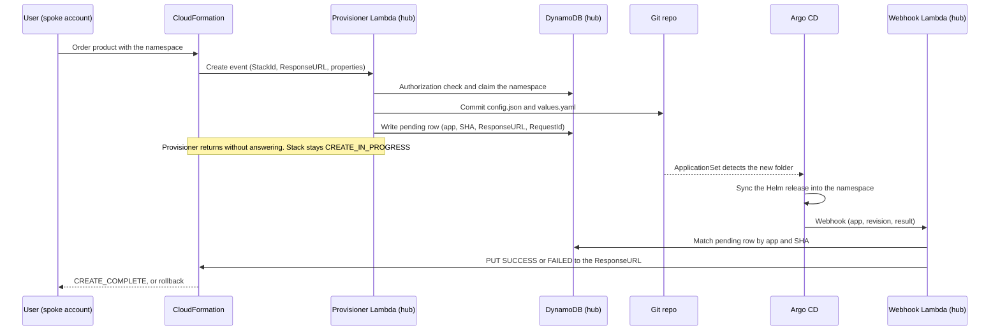
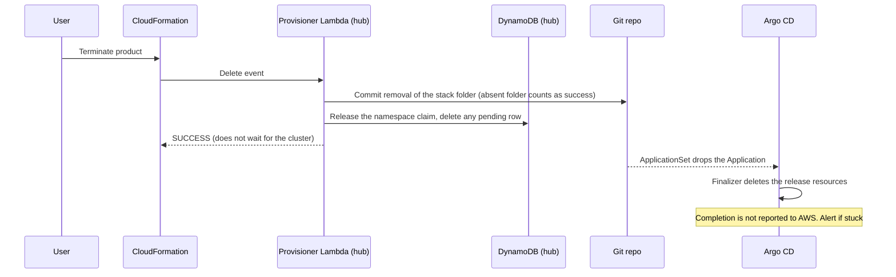

# Namespace deployment product: operations end to end

How Create, Update and Delete are handled, from the user's order in a spoke account to the Helm release running in an existing OpenShift namespace.

Status: draft, 2026-10-16. Decisions that are not made yet are marked **OPEN** and collected in section 9.

---

## 1. Who does what

| Component | Where | Role |
| --- | --- | --- |
| Service Catalog product + CloudFormation stack | Spoke account | Collects the inputs, calls the hub through a custom resource |
| Provisioner Lambda | Hub account, in a VPC | Only writer to Git. Validates, claims the namespace, commits, writes the pending row |
| DynamoDB registry | Hub account | Which account may use which namespace, and who currently holds it |
| DynamoDB pending table | Hub account | One row per operation waiting for Argo CD |
| Private Git repo | Git server | One folder per stack. Only the provisioner's Git app can push |
| Argo CD (ApplicationSet, one AppProject per account, Notifications) | OpenShift cluster | Deploys the Helm release and reports the sync result |
| Webhook Lambda | Hub account | Receives Argo CD events and answers CloudFormation |

---

## 2. Rules that apply to every operation

1. **Identity comes from the event, never from user input.** The account ID is read from the `StackId` ARN that CloudFormation puts in the event.
2. **The Git path comes from `StackId`.** Folder: `stacks/ACCOUNT_ID/STACK_UUID/`. The namespace is written inside `config.json`, not in the path.
3. **The namespace is immutable** for the life of a stack.
4. **One writer.** Only the provisioner writes to Git. Argo CD has a read-only credential. Branch protection allows only the Git app to push to `main`.
5. **Create and Update answer CloudFormation only when Argo CD reports the exact commit synced and healthy.** Delete answers after the Git commit.
6. **Every handler is idempotent and always answers.** The code is wrapped so an exception becomes a FAILED response, and `ServiceTimeout` on the custom resource is the backstop.
7. **Duplicate invocations are expected.** The pending row stores the CloudFormation `RequestId`. A call whose `RequestId` already has a row is a retry: do not commit again, keep waiting.

### What the repo contains

```
stacks/
  ACCOUNT_ID/
    STACK_UUID/
      config.json    account, stackId, namespace, chartRepo, chart, chartVersion
      values.yaml    allowed parameters only
```

One ApplicationSet (Git files generator on `stacks/*/*/config.json`) turns every `config.json` into an Argo CD Application named `ACCOUNT_ID-STACK_UUID`, in the AppProject `stacks-ACCOUNT_ID`.

### Authorization and service account

- **Authorization (OPEN, pick one):**
  - **A. Registry filled at account creation.** The account vending machine writes the registry item (account to namespace), the AppProject destination and the namespace label. The provisioner only checks.
  - **B. Namespace derived from the account.** The provisioner builds the name from the account ID in `StackId` plus what the user typed. Ownership holds by construction, but the namespace must then be created and labeled by something (it no longer pre-exists).
- **No service account input from the user.** If Argo CD application sync impersonation is available, the registry stores one service account per namespace and the provisioner copies it into `config.json`. If not, there is no service account field at all.

---

## 3. Create



### Steps

1. **Order.** The user picks the product and enters the namespace (and an optional chart version). The template regex checks the format only.
2. **Launch.** Service Catalog assumes the launch role. CloudFormation invokes the hub provisioner through `ServiceToken` (same Region as the stack) with `ServiceTimeout` set.
3. **Validate.** The provisioner reads the account ID from `StackId`, runs the authorization check (section 2), and checks the chart version against the allowlist. Any failure answers FAILED at once with a readable reason.
4. **Claim.** Conditional write on the registry: `claimedBy = STACK_UUID` only if empty. If another stack holds the namespace, answer FAILED. Two simultaneous orders cannot both win.
5. **Render.** Build `config.json` and `values.yaml` from the validated inputs.
6. **Commit.** Push through the Git provider API. On a conflict, retry with jitter, then FAILED. Record the commit SHA.
7. **Park.** Write the pending row: app name, SHA, ResponseURL, StackId, RequestId, LogicalResourceId, PhysicalResourceId (`ACCOUNT_ID/STACK_UUID`), TTL (`ServiceTimeout` plus a margin). Return without answering CloudFormation.
8. **Argo CD picks it up.** The ApplicationSet sees the new `config.json` (Git polling, about 3 minutes by default, shorter with a Git webhook). It creates the Application, which syncs the chart with `values.yaml` into the namespace.
9. **Argo CD reports.** Notifications fires `on-deployed` (synced and healthy) or `on-sync-failed` and calls the webhook with app name and revision.
10. **Webhook Lambda answers.** It checks the secret header, finds the row by app name, compares the revision with the stored SHA (a mismatch is an old event: ignore), checks the ResponseURL host, PUTs the response with no Content-Type (Status, PhysicalResourceId, Data.AppName), then deletes the row.
11. **CloudFormation completes.** SUCCESS gives `CREATE_COMPLETE` and the `ArgoApplication` output. FAILED or a timeout rolls the stack back, which runs the Delete flow.

### Where Create can fail

| Step | Failure | Result |
| --- | --- | --- |
| 3 | Not authorized, chart not allowed | FAILED immediately, nothing written |
| 4 | Namespace already claimed | FAILED immediately |
| 6 | Git conflict after retries | FAILED, claim released by the rollback Delete |
| 8 | `managed-by` label missing, AppProject refuses the namespace | Sync fails, webhook sends FAILED |
| 9 | Chart error, forbidden resource | Sync fails, webhook sends FAILED |
| 9 | App never becomes healthy | No event, `ServiceTimeout` ends the wait with FAILED |
| 10 | Webhook lost or cluster cannot reach it | Same as above |

---

## 4. Update

CloudFormation sends an Update event with both `ResourceProperties` and `OldResourceProperties`. The `PhysicalResourceId` stays the same, so CloudFormation does not replace the resource.

| What changed | Handling |
| --- | --- |
| Namespace | Rejected with FAILED ("namespace is immutable"). Nothing was written, the stack rolls back |
| Chart version or values | Validate, rewrite the files, new commit, new pending row, then the same path as Create steps 6 to 11 |
| Nothing in the files | True no-op. No commit means no sync and no webhook, so answer SUCCESS immediately |
| Same `RequestId` as an open pending row | Retry of a call that already committed. Do not commit again, keep waiting |

### Failed update and rollback

If the update fails (sync failure or timeout), CloudFormation rolls back by calling Update again with the old properties. The provisioner commits the old values back, writes a new pending row and waits for Argo CD as usual. If the rollback also fails, the stack ends in `UPDATE_ROLLBACK_FAILED` (see the runbook).

### Drift

- A manual change in the cluster is reverted by `selfHeal`.
- A manual change in Git is blocked by branch protection.
- CloudFormation allows one operation per stack at a time, so two updates never overlap.

---

## 5. Delete



### Steps

1. The user terminates the product. CloudFormation calls the provisioner with Delete.
2. The provisioner commits the removal of `stacks/ACCOUNT_ID/STACK_UUID/`. If the folder is already gone, that is success.
3. It releases the registry claim and deletes any leftover pending row. Missing items are success.
4. It answers SUCCESS. The stack finishes deleting.
5. In the cluster, the ApplicationSet drops the Application. The `resources-finalizer` makes Argo CD delete the release's resources first. Do not set `preserveResourcesOnDeletion` on the ApplicationSet, or the resources will stay.

### Delete is also used by rollbacks

A failed Create or a rolled-back stack runs Delete. The folder, the claim or the row may or may not exist, so every step tolerates absence. Retrying a `DELETE_FAILED` stack is safe for the same reason.

### Deletion is not confirmed to AWS

Argo CD Notifications has no event for "finished deleting". Newer versions can trigger on a deletion timestamp, which marks the start, not the end (check your version).

| Option | How | Cost |
| --- | --- | --- |
| **A. Accept (default)** | Answer SUCCESS after the commit, alert on Applications stuck deleting | The stack can show deleted while resources still run for a short time |
| B. Poll Argo CD | A Step Functions loop checks the Application is gone, with a read-only Argo CD token | Network path from hub to Argo CD, a token to rotate |
| C. Cluster-side reconciler | A small controller reports completion to AWS | One more component to build and run |

---

## 6. Concurrency and idempotency

- **Namespace claim:** conditional write, one winner.
- **Git pushes:** use the provider API with retry and jitter. If volume grows, split into several repos.
- **Duplicate invocation:** keyed on `RequestId` (see section 2, rule 7).
- **Duplicate webhook:** the first one deletes the row, the second finds nothing and does nothing.
- **Old events:** the revision check ignores events for earlier commits.
- **Abandoned rows:** the TTL on the pending table removes them.

---

## 7. Where to look

| Question | Where |
| --- | --- |
| Did CloudFormation call the provisioner? | Stack events and the provisioner's logs |
| Was it committed? | Git history of the stack folder (author is the Git app) |
| Is the operation still waiting? | Pending table, row keyed by app name |
| What does Argo CD say? | Application status: sync, health, last operation message |
| Did the webhook arrive and what did it decide? | Webhook Lambda logs (accepted, ignored, rejected, with the reason) |

Alarms to set: rejected webhook calls, pending rows older than `ServiceTimeout`, Applications with a deletion timestamp older than a set time, provisioner errors.

---

## 8. Runbook

| Symptom | Likely cause | Action |
| --- | --- | --- |
| Stack stuck in `CREATE_IN_PROGRESS` or `UPDATE_IN_PROGRESS` | Webhook not delivered, sync still running | Check the Application and the pending row. The timeout will end it. If urgent, the platform can send the response to the stored ResponseURL by hand |
| `DELETE_FAILED` | Provisioner error (Git, permissions) | Fix the cause and retry the delete. It is idempotent |
| `UPDATE_ROLLBACK_FAILED` | The rollback sync failed too | Fix the Application in Git through the provisioner path, then continue the rollback |
| Folder in Git with no stack | A Delete failed after a create | Remove the folder with the Git app, release the claim |
| Namespace claimed but no stack | Claim not released | Clear the `claimedBy` field in the registry |
| Application stuck deleting | Finalizer cannot remove a resource | Inspect the blocking resource in the namespace, then let the finalizer finish |

---

## 9. Open decisions

- [ ] **Authorization:** registry filled at account creation (A) or namespace derived from the account (B)?
- [ ] **Namespace creation:** does the namespace pre-exist, or does something create and label it? Option B needs this answered.
- [ ] **Service account:** is application sync impersonation available on your Argo CD version? If not, drop the field.
- [ ] **Chart location:** Helm repo, OCI registry or the same Git repo? It sets the source syntax in the ApplicationSet.
- [ ] **Network:** can the cluster reach a public Lambda Function URL, or is a private API Gateway needed? Is a Lambda outside a VPC allowed?
- [ ] **Delete confirmation:** is option A acceptable?
- [ ] **One cluster or several?** Several adds a cluster field to the registry and `config.json`.
- [ ] **Ownership:** who is on call for the hub components?
